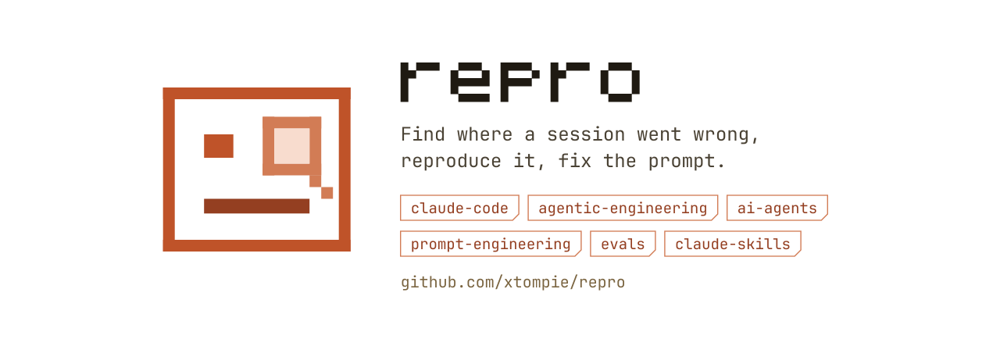

<picture>
  <source media="(prefers-color-scheme: dark)" srcset="assets/banner-dark.svg">
  
</picture>

## In short

- Reads a Claude Code session: the current one, an id, or a file.
- Finds what went wrong, or asks you which problem to take.
- Tells the model's fault from a vague prompt or a vague operator.
- Reproduces the failing step in a sandbox, several runs.
- Proposes a fix to the skill, doc or instruction.
- Reruns to prove the fix works.
- Applies it only when you say yes.

## Why

A session goes wrong and you correct the model by hand. Next time it goes wrong the same way. The usual fix is to edit a skill or `AGENTS.md` from memory and hope.

That skips two questions. Whose fault was it? A model that ignored a clear instruction, an instruction that never said the thing, or an operator who said two different things. And does the fix work? One good run proves nothing.

repro answers both. It names a cause for each moment, then tests the guess: it replays the moment several times with the real context, before and after the fix.

## How it works

```text
/repro                          this session
/repro <id or path>             another session
/repro <id> <what went wrong>   go straight to that moment
```

1. **Read.** The session is turned into short numbered turns: your messages, the model's answers, one line per tool call.
2. **Suspects.** Each moment where the result differed from what you wanted gets a cause: `ignored`, `gap`, `operator` or `unknown`. You pick one.
3. **Operator.** If the cause is you, repro says what was unclear and gives the sentence to use next time. Nothing is replayed.
4. **Reproduce.** In a git worktree inside the project, repro cuts the session just before the failing message and replays it as a fork, 5 times by default. The real session is never changed. For a gap, your final correction is the expected result.
5. **Fix.** The smallest text change, in the one file that owns the rule.
6. **Prove.** The same runs again with the fix. 5 of 5 failing before and 0 of 5 after is enough. Weaker results are reported as weaker.
7. **Apply.** You see the diff and the counts. Nothing changes until you say yes. The sandbox is removed.

## Install

Paste this into Claude Code:

```text
Install repro from https://github.com/xtompie/repro. Follow INSTALL.md from that repo.
```

To upgrade, paste the same line with "Upgrade" instead of "Install". The agent reads the installed version and applies what changed since, from `CHANGELOG.md`.

The skill installs for your user by default, so it works in every project.

Requirements: Claude Code 2.1.310 or newer, macOS or Linux, `git`, `perl` (core modules only).

## Relies on Claude Code internals

repro reads session files from `~/.claude/projects/` and replays them with `claude -p --resume <file> --fork-session`. The file format is not documented. A Claude Code update can change it; the converter and `cut.pl` are the two places to fix.

Replays run with `--permission-mode acceptEdits` inside the throwaway worktree. Everything else follows your own permission settings.

## Tests

```bash
tests/run.sh                 # every case, twice, on Haiku
tests/run.sh converter       # no model
tests/run.sh reproduce --runs 1
```

Cases with a model run a real `claude -p` in a fresh temp project, with the skill installed as `rp`. Fixture sessions live in `tests/fixtures/`.

## Credits

- [Open Mercato](https://github.com/open-mercato/open-mercato): the session judge and the harness loop that starts from a failing case.
- Tang et al. 2026, causes of failure in 20,574 real agent sessions: the split into ignored, ambiguous and undecidable.
- [SkillOpt-Sleep](https://github.com/microsoft/SkillOpt-Sleep): replaying sessions to test small instruction edits.
- [mentor](https://github.com/xtompie/mentor): the shared session converter.
